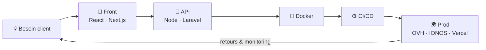

<div align="center">

# 👋 Salut, moi c'est Andritina

### Développeur Fullstack JavaScript & DevOps — *je code l'app, puis je la mets en prod* 🚀


<br/>



</div>

---

## 🐳 À propos de moi — version `docker-compose`

> Plutôt qu'un objet JavaScript, voici comment je me décris : comme une stack que je déploie.

```yaml
# andritina.yml
services:
  andritina:
    image: fullstack-devops:latest
    restart: always            # je ne lâche pas un bug avant qu'il soit corrigé
    environment:
      ROLE: "Développeur Fullstack & DevOps"
      FOCUS: "React, Next.js, Node.js, Laravel"
      INFRA: "Docker, Nginx, VPS OVH & IONOS, Vercel"
      LEARNING: "AWS, Kubernetes, observabilité"
      GOAL: "Des apps performantes, élégantes et utiles — et qui restent en ligne"
    volumes:
      - ./playlist:/nuit-de-code   # 🎧 je peux coder toute la nuit avec une bonne playlist
    healthcheck:
      test: ["CMD", "curl", "-f", "https://andritina-tonny.onrender.com"]
      interval: 24h
```

- 🔭 Je développe des applications **React / Next.js / Node.js** et des back-ends **Laravel**
- 🖥️ Je gère le **déploiement multi-projets** de plusieurs clients sur des **VPS OVH et IONOS** (Docker, Nginx, SSL, migrations)
- ⚙️ J'automatise tout ce qui peut l'être : **CI/CD**, conteneurisation, mises en production
- 🌱 En ce moment j'approfondis **AWS** et l'orchestration de conteneurs

---

## 🔁 Ma façon de livrer un projet



---

## 🛠️ Stack Technologique

<div align="center">

### Frontend


### Backend


### Bases de données


### Infra & DevOps


</div>

---

## 📊 Mes Stats GitHub

<div align="center">


</div>

---

## 🚀 Projets récents

<div align="center">

<!-- Remplace NOM_DU_REPO par tes dépôts publics -->
<a href="https://github.com/Andritina/NOM_DU_REPO_1">
  
</a>
<a href="https://github.com/Andritina/NOM_DU_REPO_2">
  
</a>

</div>

---

## 🌐 Connectons-nous

<div align="center">

[](https://linkedin.com/in/andritina)
[](https://andritina-tonny.onrender.com)
[](mailto:tonny.andritina@gmail.com)

</div>

---

<div align="center">

```bash
$ git commit -m "Coder, c'est créer quelque chose à partir de rien — puis le mettre en ligne."
```


⭐️ N'hésitez pas à consulter mes repos et à me contacter pour collaborer ! 🤝

</div>
